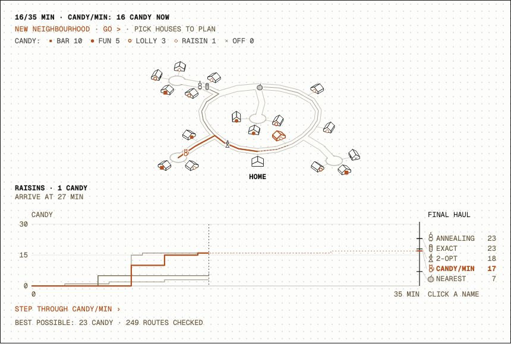
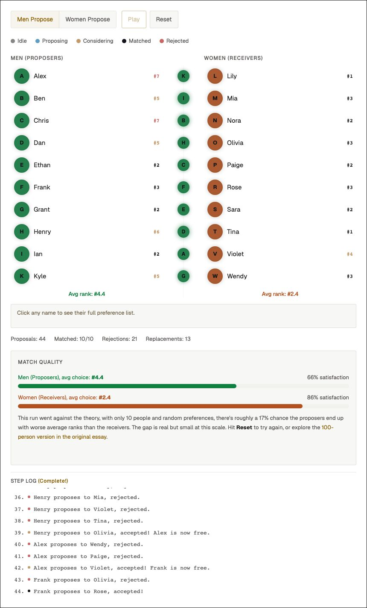
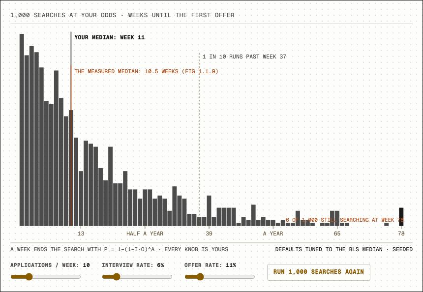
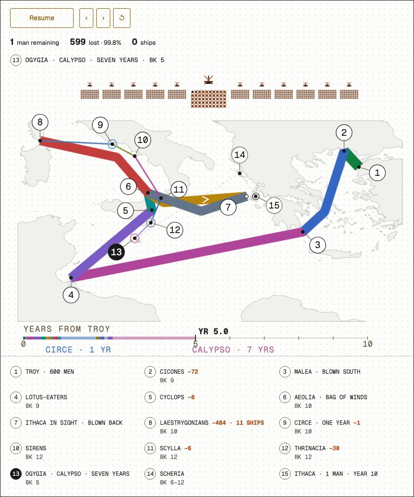

# Interactive figures

Four interactive explanations from [my site](https://www.andrewfribush.com): plan a Halloween candy route, switch who proposes in stable matching, rerun a thousand job searches, or follow the Odyssey's dwindling crew. You can run, inspect, and change each figure locally.

The algorithms and drawings are written together in React and TypeScript, with SVG and HTML for rendering. Routes follow a generated street graph; the Odyssey's band widths, ship counts, and timeline share one schedule. Forty-one tests cover route algorithms, geometry, and interaction behavior. The exact planner distinguishes a proved optimum from the best route it found before hitting its search cap.

No charting library, API key, account, or backend is needed. The original figures remain available on [andrewfribush.com](https://www.andrewfribush.com/figures).

## The collection

| Figure | What to explore | Live demo | Source |
| --- | --- | --- | --- |
| Trick-or-treat routes · 1.1.15 | Five planners optimize candy collected before curfew | [Play](https://www.andrewfribush.com/fig/1.1.15) | [Figure](src/figures/TrickOrTreat.tsx), [algorithms](src/figures/TrickOrTreat.algos.ts) |
| Stable matching · 2.1.1 | Compare deferred acceptance with either side proposing | [Play](https://www.andrewfribush.com/fig/2.1.1) | [Figure and algorithm](src/figures/GaleShapleySimulator.tsx) |
| A thousand job searches · 1.1.12 | See the distribution produced by three probability assumptions | [Play](https://www.andrewfribush.com/fig/1.1.12) | [Figure and model](src/figures/SearchSimulator.tsx) |
| The return from Troy · 1.1.2 | Follow a narrative flow map from 600 men to one | [Play](https://www.andrewfribush.com/fig/1.1.2) | [Figure and schedule](src/figures/OdysseyReturn.tsx) |

## Run locally

Use Node.js 22.22.2 or later in the 22.x line, 24.15.0 or later in the 24.x line, or 26+. The lockfile pins the dependency tree.

```sh
git clone https://github.com/AndrewFribush/interactive-figures.git
cd interactive-figures
npm ci
npm run dev
```

Open the localhost address printed by Vite. The index links to all four figures. Direct links use `?figure=trick-or-treat`, `?figure=stable-matching`, `?figure=job-search`, and `?figure=odyssey`.

```sh
npm test           # 41 algorithm, geometry, and interaction tests
npm run build      # TypeScript check and production bundle
npm run preview    # Serve the built bundle locally
npm run check      # Tests and build, also used by CI
```

`dist/` contains a static site. Assets use a relative base, so the build can live in a subdirectory. This repository has no deployment workflow.

## Trick-or-treat routes

[](https://www.andrewfribush.com/fig/1.1.15)

Click houses to plan a route, race all walkers, then select a planner and step through its reasoning. Every candidate route includes the walk home before curfew. Forgetting that part would make every planner look rather clever.

The [town generator](src/figures/TrickOrTreat.town.ts) builds seeded street graphs, houses, and candy rewards. Distances follow the streets and satisfy the triangle inequality after rounding. The [planners](src/figures/TrickOrTreat.algos.ts) compare nearest-neighbor and candy-per-minute greedy choices; 2-opt reversals followed by insertion; seeded simulated annealing; and branch-and-bound search with a fractional-knapsack upper bound. The exact search is capped at 300,000 partial routes and explicitly distinguishes a proved optimum from the best route found before the cap. This is a small orienteering problem, not a shortest route through every house.

The tests compare exact search with an independent subset dynamic program on small boards, require routes to return before curfew, exercise the search cap, and check house placement against visible road and house geometry. UI tests cover resizing, stale selections, and Strict Mode behavior.

## Stable matching

[](https://www.andrewfribush.com/fig/2.1.1)

Play a round, inspect a person's preferences, then switch which group proposes. Switching sides keeps the underlying preferences fixed so you can compare the two outcomes. Reset creates new random rankings.

The [generator](src/figures/GaleShapleySimulator.tsx) yields each proposal's result and a reducer updates the view. Receivers keep their preferred proposal so far and release a previous match when a better proposal arrives. Under these complete, strict preference lists, deferred acceptance terminates in a stable matching. “Stable” means no unmatched pair prefers each other to their assigned partners; it does not mean first choices for everyone. The ten-person example is synthetic, and random small samples need not produce a lower mean rank for the proposing group. The [original essay](https://www.andrewfribush.com/blog/women-should-ask-men-out) adds the wider context and a larger simulation.

## A thousand job searches

[](https://www.andrewfribush.com/fig/1.1.12)

Change applications per week, interview rate, or offer rate, then rerun the sample. The median and upper tail show how widely outcomes can vary under the same assumptions.

The [model](src/figures/SearchSimulator.tsx) assumes independent applications with constant probabilities. With `a` applications per week, interview probability `i`, and conditional offer probability `o`, a week succeeds with probability `1 − (1 − i·o)^a`. A seeded random generator draws 1,000 search durations, censored at 78 weeks. Defaults were tuned near a [BLS/FRED median](https://fred.stlouisfed.org/series/UEMPMED); the included observation snapshot ends in July 2026 and does not update itself.

This is an illustrative probability model, not a prediction for an individual job seeker. The BLS series measures duration of unemployment among people still unemployed, while the simulation measures time to a first offer. The line supplies context; sharing a chart with official statistics does not validate the model. Application dependence, changing odds, labor-market differences, and competing reasons for ending a search are outside its scope.

## The return from Troy

[](https://www.andrewfribush.com/fig/1.1.2)

Play the voyage, step between stops, or drag its timeline. The band width records men remaining; the ship muster and years elapsed follow the same schedule, so the drawing and its counters stay in agreement. Numbered callouts connect the map to a readable stop key below it. On a phone, scroll the map sideways; the key fits the screen.

The [SVG renderer](src/figures/OdysseyReturn.tsx) applies Minard's flow-map idea to the Odyssey. Travel segments advance with chart distance; stays advance with story time. A compiled [Natural Earth coastline](src/figures/map-data/mediterranean.ts) supplies the geographic context. Place identifications are traditional and interpretive: this is a reading of a poem, not a claim to have reconstructed a historical voyage. The 600-man starting muster is the figure's explicit ship-accounting assumption.

## What is included

The four renderers, their local data and helpers, the route planner's existing tests, a small Vite gallery, fonts, and screenshots. Figures are loaded separately so opening one does not load the other three. The source was extracted from my personal site at commit `ecdae4931aec5ad6cf62b3ab461dfc5d679e697d`; [provenance.json](provenance.json) records each original path and SHA-256 hash, plus the few standalone adaptations. The algorithms and drawing geometry are preserved. A small matching UI fix keeps the completed state visible after the algorithm finishes; a focused component test covers that behavior.

The Odyssey presentation moves crowded labels into numbered callouts and a responsive stop key, with counts above the map; its data, route geometry, and timing are unchanged. Gallery thumbnails show the upper matching diagram and the Odyssey map; the full screenshots shown here retain the surrounding notes and controls.

The wrapper uses the source site's ink, amber, and Geist typography. Next.js directives and imports are adapted for Vite; an essay continuation links back to the original article. Screenshots show the local gallery, captured on 2026-10-03. The matching screenshot is a random sample; the other figures use their recorded default state or a paused voyage.

Code and original artwork are copyright Andrew Fribush, all rights reserved; publication is not an open-source license grant. See [NOTICE](NOTICE) and [ATTRIBUTION.md](ATTRIBUTION.md) for data, fonts, and third-party terms.

[Development history](HISTORY.md) preserves the original changes to the four figures and their local dependencies.
